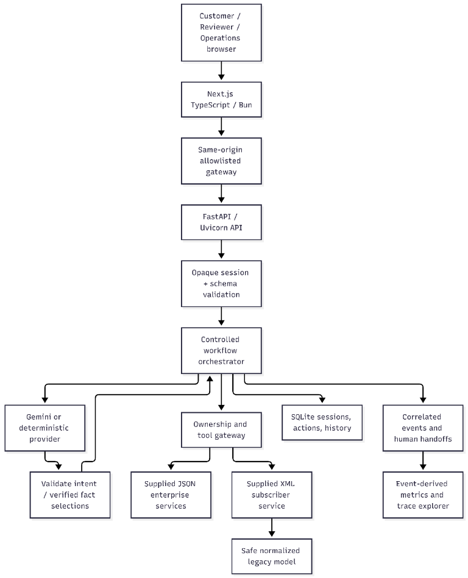
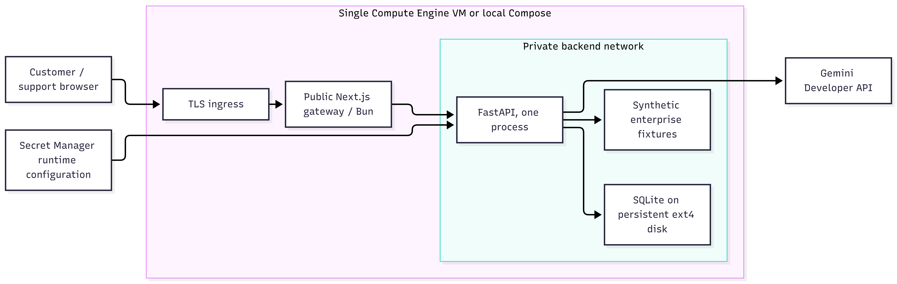

# How Relay CX works

Relay CX is a demo support app for a made-up phone and internet company. A
customer can ask about their account, bill, or service. The app checks sample
company records and explains what it found.

## The short version

1. You use the website and sign in.
2. The website sends your request to the app's backend.
3. The backend checks who you are and what account you can access.
4. It reads the matching sample records.
5. Gemini may help understand the question and choose which verified facts to
   show. It cannot choose another customer's account or create a case.
6. The app saves a record of what happened.

If the app is about to create a support case, it shows you what it plans to do
and waits for you to confirm. A message such as “yes” in the chat is not enough.

## Main parts

| Part | In plain language |
|---|---|
| Website (Next.js) | The pages customers and support staff use. |
| Backend (FastAPI) | Checks requests, runs the support steps, and controls access. |
| Gemini (through Google ADK) | Helps understand a question and select facts. It cannot access accounts by itself. |
| Enterprise gateway | The only route from the backend to the sample company services. |
| Sample services | Fake account, billing, network, and legacy subscriber records. |
| SQLite database | Saves local sessions, case actions, and activity records. |

## What happens when something goes wrong

If the request is unclear, the app asks a question before reading protected
records. If records disagree or a service fails, it tells you that it could not
finish and prepares the request for a human. If Gemini is unavailable, the app
shows a degraded status; it does not pretend that Gemini succeeded.

The activity records connect each request to its steps and results. They do not
store raw passwords, Gemini prompts, provider replies, or XML documents.

## Important limits

This is a local demo that uses fake company data. It runs with one backend
process and a local SQLite database. It is not ready to serve real telecom
customers or to run across multiple servers.

The cloud picture below shows a possible setup; it is not a running cloud
deployment.

See the [deployment guide](../deployment/README.md) before running the app
outside a local demo.
