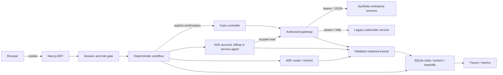

# Architecture

## Deployment and trust boundaries

Google ADK supplies validated interpretation and invokes a session-bound read tool before ordering verified facts. It cannot select customer IDs, URLs, arbitrary tools or case writes. Customer browsers cannot reach enterprise fixtures. API state and traces remain on the trusted backend. GCP resource provisioning has not been executed. See deployment/README.md for operational setup and scaling limits.

## Components and authority

| Component | Responsibility and boundary |
|---|---|
| Next.js BFF | Allowlisted routes, origin checks, streaming 8 KiB body limit; no enterprise URLs or keys in browser code |
| FastAPI transport | Strict request schemas, cookie/session and separate customer/support roles |
| ResolutionService | Explicit transitions, context, fallback, conflict handling, proposal and handoff |
| ADK router | Redacted messages to strict intent/service/confidence; no tools or credentials |
| ADK specialist | One session-bound read tool; exact ordering of verified fact IDs; no write authority |
| Enterprise gateway | Authenticated fixed paths; pre-fetch ownership checks, returned identity validation, safe bounded retries |
| CaseActions | Matching explicit confirmation, expiry, durable execution claim, receipt verification; no ambiguous write retry |
| Store | SQLite WAL: sessions, actions, events, handoffs, metrics; single API process |
| Synthetic services | Supplied JSON/XML fixtures; independent bearer/expiry/ownership checks; private network |

## Workflow and termination

NEW → INTERPRETING → NEEDS_CLARIFICATION, or AUTHORIZATION_CHECK → FETCHING_ENTERPRISE_DATA → ANALYZING_RESULTS → RESOLVED. Unknown intent/service asks a specific question before protected reads. Clarification retains bounded context and resumes. Foreign account IDs are denied before interpretation/retrieval. Case proposals enter AWAITING_CONFIRMATION; matching explicit confirmation enters EXECUTING_ACTION → VERIFYING_ACTION → RESOLVED. Conflicts and enterprise errors escalate. Provider failure switches visibly to DEGRADED; deterministic permissions remain active. Uncertain actions cannot retry automatically.

One specialist runs per inquiry; there is no recursive delegation or agent messaging. Router context is at most four redacted messages. Specialists receive intent/service and normalized facts through their own tool, without identifiers in arguments. Repeated calls reuse the evidence bundle. Every fact ID must appear exactly once; unsupported facts or prose are rejected. Conflicts are checked in code. Durable application state survives API restart; ADK context is ephemeral. Handoffs retain prior verified evidence with original trace/time and keep it separate from current facts.

## Telemetry semantics

Events validate against the supplied schema including formats, sanitize recursively and persist before presentation. IDs correlate requests, sessions and steps. Tool events include duration/status/retries and sanitized summaries. ADK run/tool events show actual execution. No raw credentials, prompts, provider responses or XML are logged. SQLite is authoritative when the JSONL mirror cannot be written.

Metrics cover persisted events since database initialization. Resolution/escalation/failure/handoff divide counts by request.received, including overview reads and confirmation requests. Average workflow duration uses request.finished. Tool success uses tool.finished. Retry rate is retries/tool completions and can exceed one. Gemini metrics include explicitly labeled simulated failures (`metadata.simulated`); filter for live-only monitoring. Component usage is event-counted. Empty denominators yield zero. These are observed technical metrics, not forecast business KPIs. Production retention/incremental aggregation/export remain extension points.
