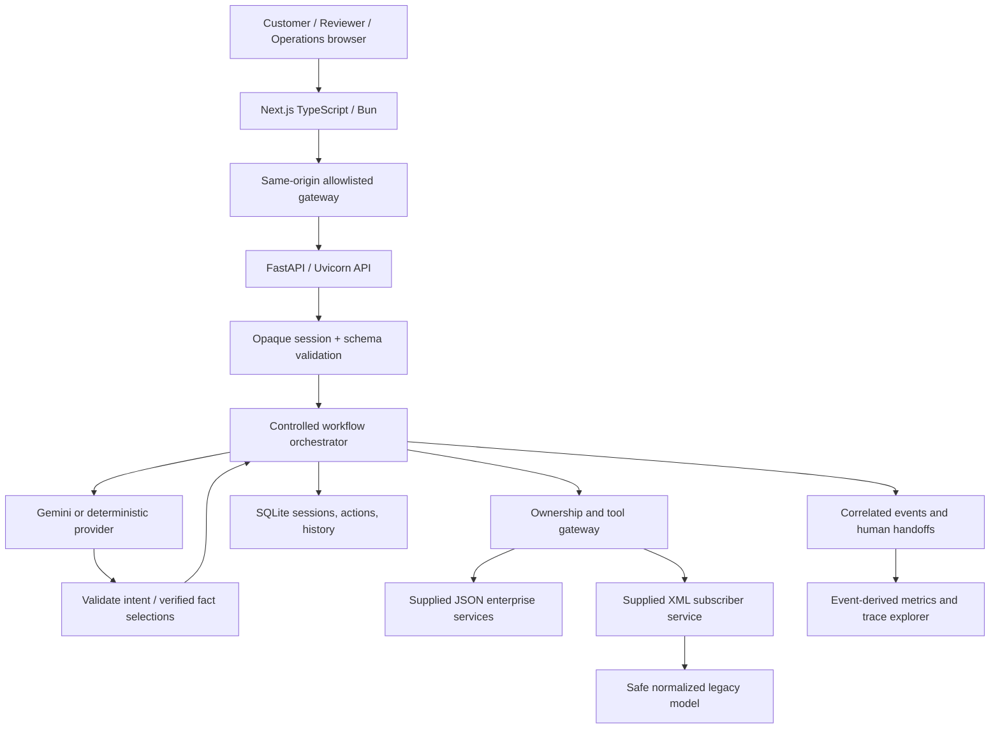
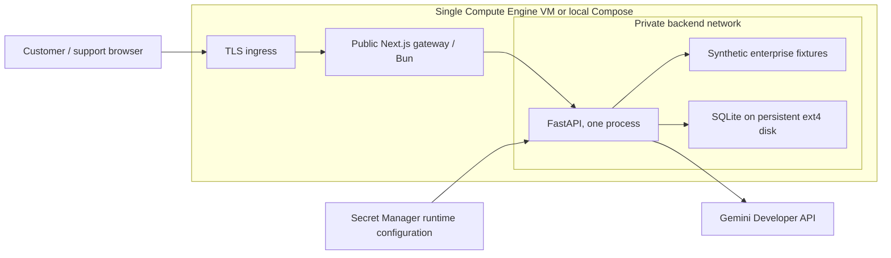

# Architecture

`http/app.py` owns HTTP, cookies, origin/body validation and support-role endpoints. `domain/models.py` defines strict client/AI schemas and enterprise response models. `application/workflows.py` owns transitions, context, proposals, fallback and handoff; `application/case_actions.py` owns confirmation execution. `agents/runtime.py` runs Google ADK routing and specialist read tools. `application/evidence.py` collects authorized normalized evidence. `ai/providers.py` contains explicit Reviewer interpretation and shared redaction/error rules. `infrastructure/enterprise.py` owns allowlisted paths, ownership, membership, response checks, timeout/retry classification and XML. `infrastructure/storage.py` owns durable data and derived measurements. `evaluation/scenarios.py` executes supplied scenario assertions through the same business layer; `tools/evaluate.py` verifies its role-restricted HTTP entry point.

Customer text is redacted before persistence/model use. Auth-service identity binds the session, and protected lookups are restricted to that binding. Profile/account response identity must agree. The gateway obtains only session-owned service IDs. Raw credentials/tokens are discarded. Model outputs contain only a bounded intent, service type and confidence; confidence never changes permissions. Response selection is a permutation of verified fact IDs. Text is rendered deterministically and escaped by React, including enterprise strings.

## Workflow

A request starts NEW → INTERPRETING → NEEDS_CLARIFICATION, or AUTHORIZATION_CHECK → FETCHING_ENTERPRISE_DATA → ANALYZING_RESULTS → RESOLVED. Case requests branch from fetching to AWAITING_CONFIRMATION. The confirm route rechecks authorization, action identity, age and durable status, then EXECUTING_ACTION → VERIFYING_ACTION → RESOLVED. Integration failures become ESCALATED; access denials become FAILED. A new request begins a new bounded trace, retaining prior customer context for unresolved clarification. The transcript retains the last 40 messages, and clarification interpretation uses at most four customer messages.

The transition table rejects invalid workflow steps. A terminal/waiting state may start a new request; request entry and security-denial state assignment are explicit resets. Two bounded ADK stages perform routing and evidence retrieval. The request router has no tools; one specialist receives exactly one authorized read tool. Each runner permits at most three model calls. Repeated specialist tool calls reuse cached evidence. Case writes are controlled by CaseActions, outside ADK. Independent WAL readers let authenticated customers poll committed progress while a run is active. A process RLock serializes session mutation and action execution, and SQLite saves before/after external action submission. Deployment is single-process; multi-instance coordination is not claimed.

## Integration semantics

Trusted base URL plus fixed operation paths prevents model-selected URLs. Requests propagate X-Correlation-ID. JSON models reject missing required fields. Profile/account/billing/diagnostics/case identities are checked; billing items reconcile to total. Redirects are disabled. Response bodies are bounded at 256 KiB. GETs, XML subscriber lookup and read-only diagnostic POST can retry transient transport/429/5xx at most MAX_RETRIES (0–2). Authentication and support-case POST are not retried. Local timeout is a socket transport timeout, not a whole-workflow deadline; it is not a protection against deliberate slow-drip servers.

XML must be UTF-8 without nulls, DTD or ENTITY declarations. Required unique fields, response root, account/service match and legacy status codes are checked. Error codes 101/102/205/301/429/503/900 map to specific integration reasons. A successful HTTP response is not considered a successful legacy tool call until normalization succeeds. No external resource resolution is allowed.

Each handoff records escalationId, traceId, redacted request summary, verified account context, completed tools across proposal/confirmation requests, failed tools, reason, next action, facts and pending status, matching the supplied escalation schema. Internal processing exceptions create a correlated safe handoff without storing exception text. It is an internal SQLite queue; no external delivery is claimed.

## Telemetry and metric definitions

Events are validated at ingestion against the supplied telemetry schema. Invalid payloads are rejected without retention; telemetryRejected counts rejections. Accepted events persist in SQLite and a redacted JSONL mirror. Tool events include sanitized input/output summaries. History/handoff data remains role restricted. Explicit intent, clarification, authentication, agent/tool, confirmation, fallback and terminal events support sequence investigations.

Every metric uses **all persisted events since database initialization**. Empty denominators return 0. These are request-level rates, not unique business-issue resolution rates; a confirmation is a separate request and duplicate confirmations do not add a resolution event.

| Metric | Numerator | Denominator |
|---|---|---|
| Sessions | session.created count | count |
| Requests | request.received count | count |
| Resolution rate | workflow.resolved count | request.received count |
| Escalation/handoff rate | workflow.escalated count | request.received count |
| Failure rate | failed request.finished count | request.received count |
| Average workflow duration | sum request.finished durationMs | request.finished count |
| Tool success rate | successful tool.finished count | tool.finished count |
| Failures by integration | failed tool.finished grouped by component | count |
| Auth failures / denials | authentication.failed / authorization.denied count | count |
| Gemini failures | failed ai.finished count | count |
| Gemini latency | sum ai.finished durationMs | ai.finished count |
| Tool usage | tool.finished grouped by component | count |
| Retry frequency | tool.retry count | tool.finished count |

Gemini measurements include explicitly marked injected failures; no live success is emitted in ordinary reviewer mode. Tool duration includes safe retry time; each logical operation emits one tool.finished after normalization and identity/consistency checks. Invalid records therefore contribute failed tool events and integration failure metrics. Metrics use linear event scans; indexed SQL aggregates/export are future production improvements. Agent usage counts agent.invoked by component, and telemetryRejected counts schema rejection records without retaining invalid payloads.

## Deployment and trust boundaries

Google ADK supplies validated interpretation and invokes a session-bound read tool before ordering verified facts. It cannot select customer IDs, URLs, arbitrary tools or case writes. Customer browsers cannot reach enterprise fixtures. API state and traces remain on the trusted backend. GCP resource provisioning has not been executed. See deployment/README.md for operational setup and scaling limits.
